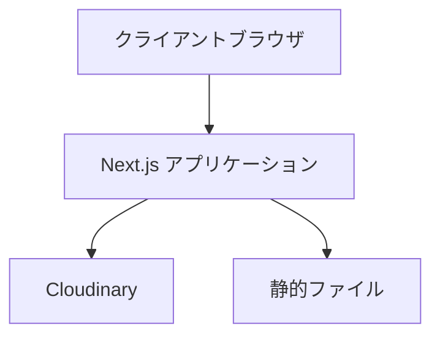
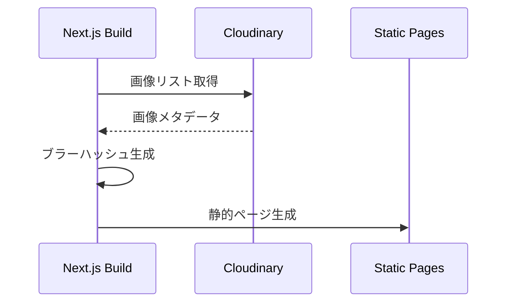
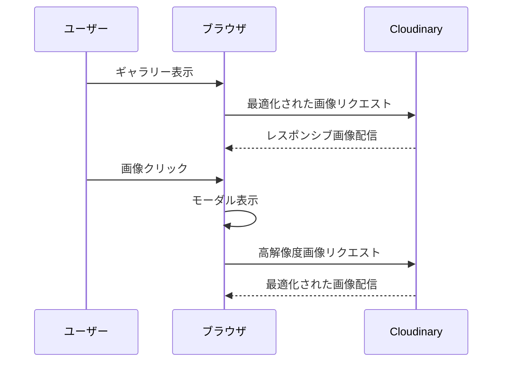

# システム設計仕様書

## アーキテクチャ概要

このアプリケーションは、Next.jsを使用したJAMstackアーキテクチャを採用しています。



## コンポーネント構成

```mermaid
graph TD
    subgraph Pages
        Index[pages/index.tsx]
        Photo[pages/p/[photoId].tsx]
        App[pages/_app.tsx]
        Document[pages/_document.tsx]
    end

    subgraph Components
        Header[Header]
        Modal[Modal]
        SharedModal[SharedModal]
        Carousel[Carousel]
        Icons[Icons]
    end

    subgraph Utils
        Cloudinary[cloudinary.ts]
        Types[types.ts]
        Animations[animationVariants.ts]
        BlurPlaceholder[generateBlurPlaceholder.ts]
        LastViewed[useLastViewedPhoto.ts]
    end

    Index --> Header
    Index --> Modal
    Photo --> SharedModal
    SharedModal --> Carousel
    Modal --> SharedModal
```

## データフロー

1. 静的生成（ビルド時）


2. ユーザーインタラクション


## 主要コンポーネントの責務

### Pages
- `index.tsx`: メインギャラリーページ、画像グリッド表示
- `p/[photoId].tsx`: 個別画像表示ページ
- `_app.tsx`: グローバルスタイルとレイアウト
- `_document.tsx`: HTMLドキュメント構造のカスタマイズ

### Components
- `Header.tsx`: ナビゲーションヘッダー
- `Modal.tsx`: 画像モーダル表示の制御
- `SharedModal.tsx`: モーダル表示の共通ロジック
- `Carousel.tsx`: 画像カルーセル機能
- `Icons/`: SVGアイコンコンポーネント

### Utils
- `cloudinary.ts`: Cloudinary API連携
- `generateBlurPlaceholder.ts`: ブラーエフェクト生成
- `useLastViewedPhoto.ts`: 最後に表示した画像の状態管理
- `types.ts`: TypeScript型定義
- `animationVariants.ts`: Framer Motionアニメーション設定

## パフォーマンス最適化

1. **静的生成（SSG）**
   - ビルド時に全ページを生成
   - 高速なページロード
   - SEO対応

2. **画像最適化**
   - Cloudinaryによる自動最適化
   - レスポンシブ画像
   - プログレッシブローディング
   - ブラープレースホルダー

3. **状態管理**
   - 最小限の状態管理
   - パフォーマンスを考慮したコンポーネント分割

4. **アクセシビリティ**
   - キーボードナビゲーション
   - 適切なARIAラベル
   - セマンティックHTML

## セキュリティ設計

1. **API認証**
   - Cloudinary APIキーの保護
   - 環境変数による機密情報管理

2. **アセット保護**
   - Cloudinaryによる安全な画像配信
   - 適切なCSP設定

3. **XSS対策**
   - Next.jsのビルトインXSS保護
   - Reactのエスケープメカニズム

## 将来の拡張性

1. **機能追加**
   - タグ付けシステム
   - 検索機能
   - ソーシャルシェア
   - コメント機能

2. **パフォーマンス向上**
   - Streaming SSR
   - React Server Components
   - 画像最適化の更なる改善